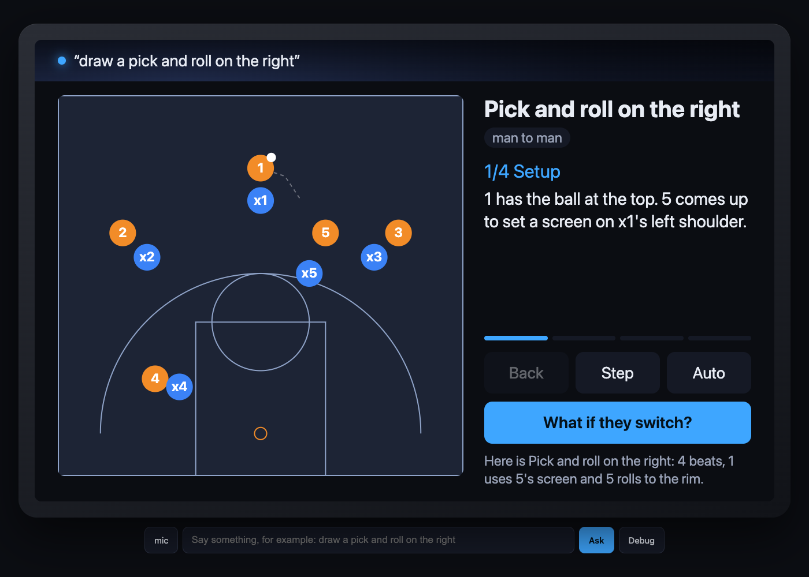

# Smart display simulator: a generic MCP Apps host in an Echo Show sized frame

A single static page that behaves like a voice assistant with a 10-inch screen. You type (or say) a
request, it picks one of your MCP server's tools without an LLM, calls it, speaks a one-line summary,
and renders the tool's MCP App view inside a 1280x800 frame with the full host-side protocol.

It exists because there is no public MCP Apps host shaped like a smart display to test against. It is
not affiliated with Amazon; it uses no Amazon or Alexa branding.



No build step: `index.html`, `sim.js`, `sim.css`. MIT licensed.

## Quick start

1. Serve this directory with any static server (or let your MCP server serve it):

   ```sh
   python3 -m http.server 8000
   ```

2. Open it with your server's Streamable HTTP endpoint:

   ```
   http://localhost:8000/?server=https://your-host/mcp
   ```

   Without `?server=` it uses `/mcp` on its own origin, which is what you want when your server
   serves the simulator itself (see `dev/fake_chalk_talk.py` for a Starlette example).

3. Type a request. The matching tool runs and its view appears in the frame. Press **Debug** for the
   raw JSON-RPC traffic, the far-field lint, the tool list and the settings.

Your server must allow cross-origin browser calls when it lives on another origin: CORS
`allow_origins=["*"]`, methods `GET, POST, DELETE, OPTIONS`, headers `*`, and expose `Mcp-Session-Id`.
Tested with fastmcp 4.1.3 (`mcp.http_app(path="/mcp", stateless_http=True, middleware=[cors])`),
protocol version `2025-11-25`, SSE responses parsed by JSON-RPC id. Session ids are honoured if the
server issues one.

### Query parameters and globals

| | |
|---|---|
| `?server=URL` | MCP endpoint (default: same origin `/mcp`) |
| `?intents=URL` | intents JSON (default: `window.SIM_INTENTS`, else `GET /sim-intents.json` next to the server, else none) |
| `?theme=dark\|light` | `hostContext.theme` sent to views (default dark) |
| `window.SIM` | `ask(text)`, `route(text)`, `rpc(method, params)`, `tools`, `memory`, `trafficLog`, `lastSummary` |

## How a request becomes a tool call (no LLM)

1. A wake word (`alexa`, `echo`, `computer`, `hey`, `ok`) and trailing punctuation are stripped.
2. **Intents table.** The first regex in `intents` that matches wins. Named groups become arguments.
3. **Keyword fallback.** Each tool is scored by the overlap between the utterance and the tool's name,
   title and description (name hits count double). Arguments are then pulled out with named-entity
   regexes keyed on the input schema: `enum` values found in the text, the first number for
   integer/number properties, a 4 to 8 letter code for `*code`, `xxx_1a2b3c` for `*_id`,
   `"<name> <value>"` phrases, and the remainder after `in / for / at / to / of / about` for the first
   still-missing string property (`"weather in London"` gives `city: "London"`).
4. **Memory and defaults** fill arguments that are still missing (see below), unknown keys are dropped,
   and values are coerced to the schema type (integer, number, boolean, array of strings split on
   commas and "and").
5. The tool is called. `structuredContent.summary` (or the paths in `speak`) is spoken with
   `speechSynthesis`; without one, a one-liner is generated from the first scalar fields.
6. If the tool declares `_meta.ui.resourceUri`, the resource is read once (cached) and hosted in a
   sandboxed iframe. Otherwise a plain card shows the structured content. Tool errors (`isError`) are
   spoken and shown.

### Intents JSON

```json
{
  "defaults": { "team_id": "team_demo00", "code": "KQZT", "minutes": 60 },
  "memory":   { "play_id": ["id", "play.id"], "code": ["code"] },
  "speak":    ["summary", "what_changed"],
  "intents": [
    { "tool": "counter_play", "match": "what if they (?<defence>switch|hedge|drop|zone)" },
    { "tool": "draw_play",    "match": "^(?:draw|sketch|show) (?:me )?(?:an? )?(?<description>.+)$" },
    { "tool": "practice_plan", "match": "practi[cs]", "args": { "focus": "" } }
  ]
}
```

- `match` is a JavaScript regex (case-insensitive). Named groups `(?<name>...)` become arguments;
  `args` adds constants. Order matters: put specific intents before broad ones.
- `memory` maps an argument name to JSON paths inside every tool result's `structuredContent`. After
  `draw_play` returns `{id: "ply_7f3a9c", ...}`, `memory.play_id` is `ply_7f3a9c`, so "what if they
  switch" and "send it to the TV" get the right `play_id` without saying it. Results of calls made by a
  view (through the host) update memory too.
- `defaults` fill arguments that are neither in the utterance nor in memory.
- `speak` is the list of `structuredContent` paths to read aloud, first hit wins.

A complete example lives in the Chalk Talk repo as `backend/views/sim-intents.json`.

## Hosting views (MCP Apps)

Views are hosted in `<iframe sandbox="allow-scripts" srcdoc=...>`: no same-origin access, only
`postMessage`. The host answers `ui/initialize` with protocol `2026-01-26` and this `hostContext`:

```json
{ "platform": "web", "theme": "dark", "displayMode": "inline", "availableDisplayModes": ["inline"],
  "deviceCapabilities": { "touch": true, "hover": false }, "locale": "en-GB",
  "containerDimensions": { "width": 1280, "maxHeight": 728 } }
```

Then, only after the view sends `ui/notifications/initialized`, it pushes `ui/notifications/tool-input`
and `ui/notifications/tool-result`. It honours `ui/notifications/size-changed` (clamped to the screen),
proxies `tools/call` and `resources/read` to the server, answers `ping`, opens `ui/open-link` in a new
tab, speaks `ui/message`, sends `ui/notifications/host-context-changed` when you change the theme in
Settings, and sends `ui/resource-teardown` to the previous view before replacing it. The exact
sequence with real payloads is in [PROTOCOL.md](PROTOCOL.md).

## Far-field lint

A view on a smart display is read from across a room. The lint panel checks the rendered view for:

| rule | limit |
|---|---|
| text size | every visible text node at least 24 px |
| actions | at most 2 (`button`, `[role=button]`, `a[href]`, submit inputs; a `[role=toolbar]` group counts as one) |
| carousel items | at most 5 children of `[data-carousel]` or `[role=list]` |
| spoken summary | at most 200 characters |

Because the iframe is sandboxed, the host cannot read its DOM; it appends a small probe script to the
view HTML that measures from inside and posts a `sim/lint` notification (debounced on DOM mutations).
Mark your carousel with `data-carousel` and group transport controls (back / step / auto) in a
`role="toolbar"` so they count as one action.

## Speech

- Input: the mic button appears when the Web Speech API (`SpeechRecognition`) exists, which today
  means Chrome and Edge. Typing always works.
- Output: `speechSynthesis`, muted with the checkbox in Settings (remembered in localStorage). The
  spoken text is also shown under the home screen and in the lint panel.

## Development

```sh
python3 -m venv .venv && .venv/bin/pip install "fastmcp==4.1.3" "mcp==2.3.0" uvicorn
npm i -g @playwright/cli            # for the end-to-end check
.venv/bin/python dev/fake_chalk_talk.py --port 8791   # fake Chalk Talk server + views + /sim/
python3 dev/check.py --url http://127.0.0.1:8791 --screenshots screenshots
```

- `dev/fake_chalk_talk.py`: a fastmcp server with the six Chalk Talk tools and fixture data. It inlines
  `dev/court-stub.js` into the court view and serves this directory at `/sim/`.
- `dev/check.py`: drives the simulator in headless Chromium with playwright-cli and asserts the message
  sequence, the router, memory, the lint and view-initiated `tools/call`. `--demo-url` adds a run
  against any second server to exercise keyword routing and the plain card.
- `dev/court-stub.js`: stand-in for Chalk Talk's real renderer, same exports.

Screenshots in `screenshots/` are produced by the check: `home.png`, `court.png`, `court-switch.png`,
`playbook.png`, `practice.png`, `saved.png`, `sent.png`, `debug-drawer.png`, `lights-demo.png`.

## Limitations

- Routing is regex and keyword based by design; it is a test harness, not an assistant.
- Only the POST side of Streamable HTTP is used (no GET event stream, no server-initiated requests).
- No auth headers, no elicitation, no `displayMode` other than inline.
- Verified in Chromium; the mic needs Chrome or Edge.

## License

MIT, see [LICENSE](LICENSE).
